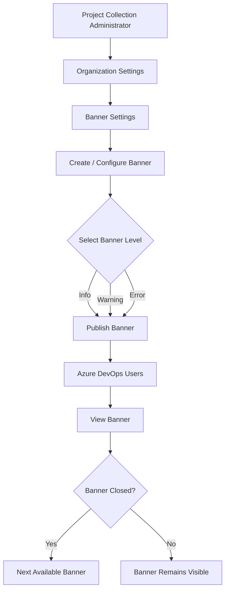
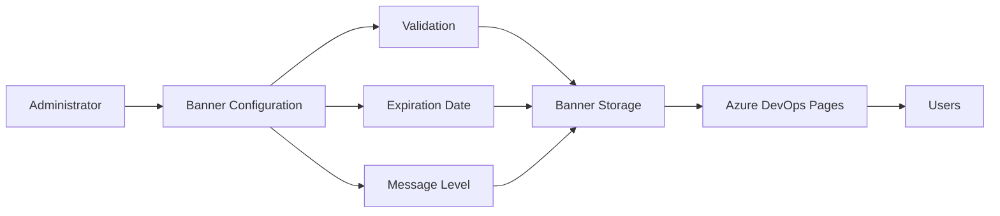
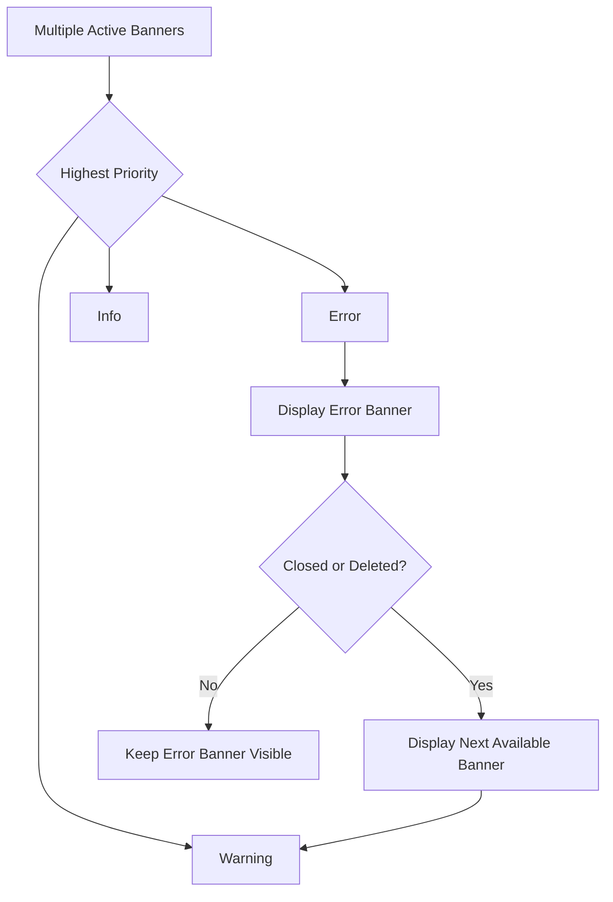

# 📢 Banner Settings for Azure DevOps

  

  <strong>Site-wide banner management for Azure DevOps</strong>

  <a href="#-features">Features</a> •
  <a href="#-how-it-works">How It Works</a> •
  <a href="#-banner-types">Banner Types</a> •
  <a href="#-installation">Installation</a> •
  <a href="#-development">Development</a>

---

## 📌 Overview

**Banner Settings** is an Azure DevOps extension that provides a settings pane under **Organization Settings**.

It allows **Project Collection Administrators** to create and display site-wide banners across Azure DevOps.

Instead of sending mass emails, administrators can use banners to communicate:

* 📢 Important announcements
* ⚠️ Upcoming changes
* 🔧 Maintenance notifications
* 📅 Upcoming events
* ℹ️ General information

The extension is compatible with **Azure DevOps Services and Azure DevOps Server**.

---

## 📸 Preview

  

### Example Banner

> ⚠️ **Windows October Update released!**
> Please visit the [Windows Insider Blog](https://blogs.windows.com/windowsexperience/tag/windows-insider-program/) for more information.

---

# ✨ Features

<table>
<tr>
<td width="50%">

### 📢 Site-wide Banners

Display important messages across Azure DevOps pages.

</td>
<td width="50%">

### 🎨 Multiple Message Levels

Choose between Info, Warning, and Error banners.

</td>
</tr>

<tr>
<td>

### 📅 Expiration Dates

Set an expiration date for each banner.

</td>
<td>

### 🔗 Markdown Links

Include hyperlinks in banner messages using Markdown.

</td>
</tr>
</table>

---

# 🚦 Banner Types

The extension supports three levels of banner messages:

| Level          | Purpose               | Example                  |
| -------------- | --------------------- | ------------------------ |
| 🟦 **Info**    | General information   | New feature announcement |
| 🟨 **Warning** | Important notice      | Scheduled maintenance    |
| 🟥 **Error**   | Critical notification | Service disruption       |

---

# 🔄 How It Works

The basic workflow of the extension can be represented as:

---

# 🏗️ Extension Workflow

---

# 🧩 Core Components

| Component                    | Description                                         |
| ---------------------------- | --------------------------------------------------- |
| ⚙️ **Organization Settings** | Provides access to banner configuration             |
| 📝 **Banner Configuration**  | Allows administrators to create and modify messages |
| 🚦 **Message Level**         | Determines banner priority                          |
| 📅 **Expiration Date**       | Controls banner availability                        |
| 🔗 **Markdown Support**      | Allows hyperlinks inside messages                   |
| 🖥️ **Azure DevOps UI**      | Displays active banners to users                    |

---

# 🥇 Banner Priority

Only **one banner can be displayed at a time** to keep the interface clean.

When multiple banners exist, they are prioritized by their level.

